# Baseer · بصير by Veebase

[](https://github.com/Hmzeid/Baseer/actions/workflows/tests.yml)

**Arabic field inspection copilot: the AI that sees, understands, and acts, in Arabic.**

*A Veebase product: designed, built and maintained by Veebase.*

## ▶ Watch the demo (3 min)

[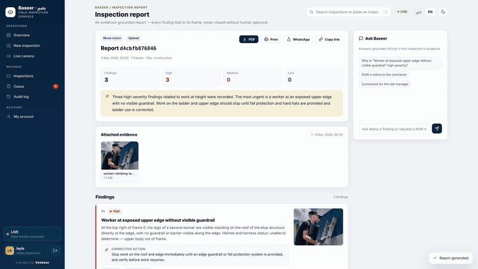](docs/media/baseer-walkthrough-web.mp4)

**[▶ Play the full 3-minute walkthrough](docs/media/baseer-walkthrough-web.mp4)**: recorded live on Meta's
Muse Spark 1.3. Every finding, chat answer, verification and camera alert in it is real model output.
GitHub plays the video on the file page that opens.

## Screenshots

| | |
|---|---|
| 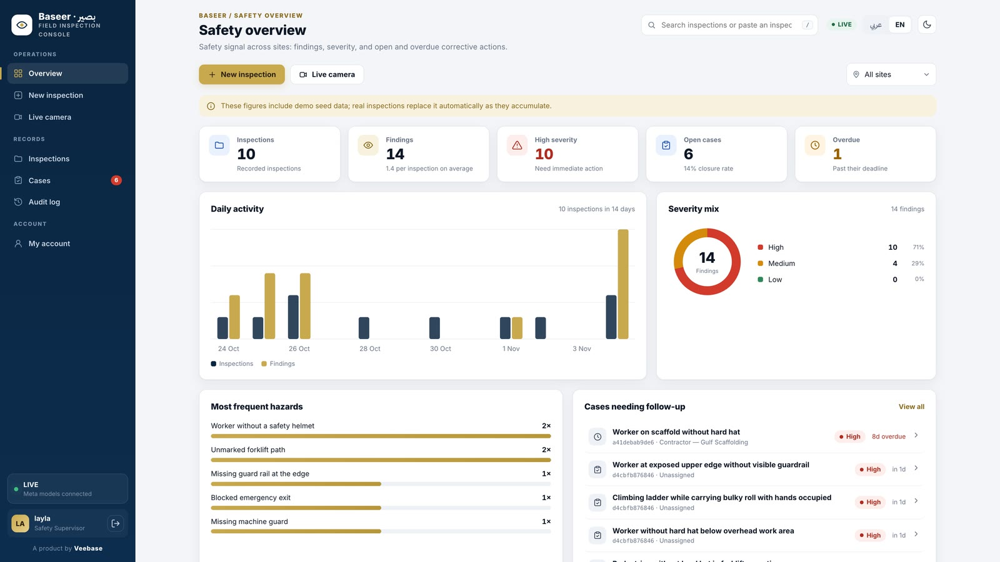 | 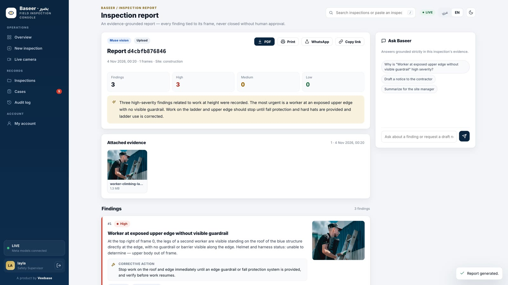 |
| **Safety overview:** KPIs, 14-day trend, severity mix, overdue cases | **Inspection report:** real Muse output on a site photo, severity strip, summary |
| 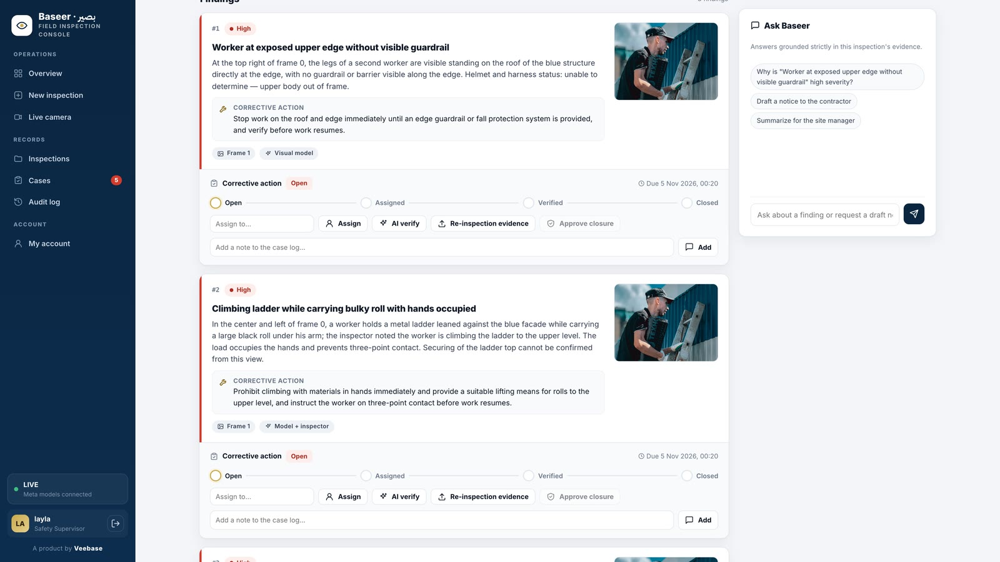 | 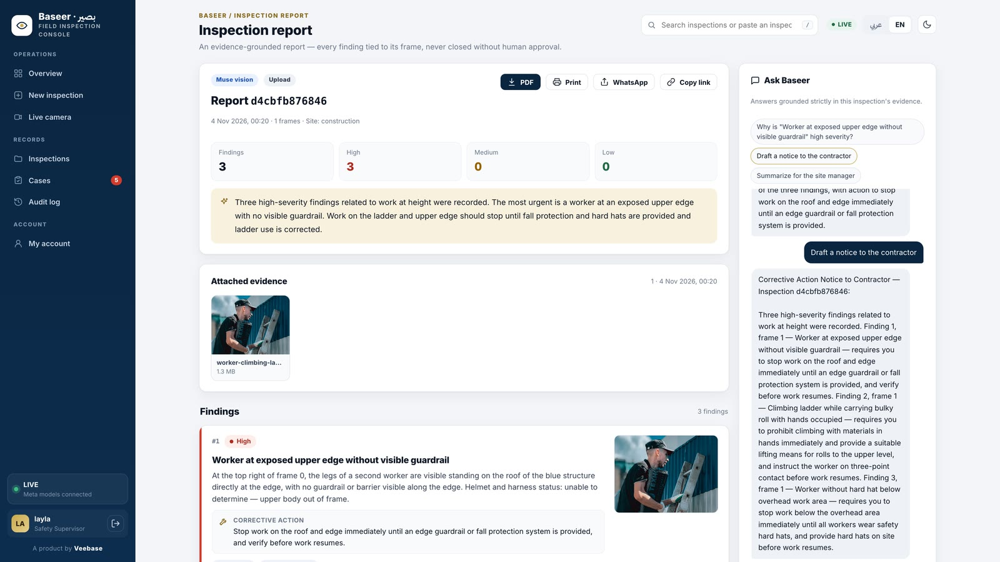 |
| **Finding:** evidence frame, what the model sees, the fix, and its case | **Evidence chat:** grounded answers and a drafted contractor notice |
| 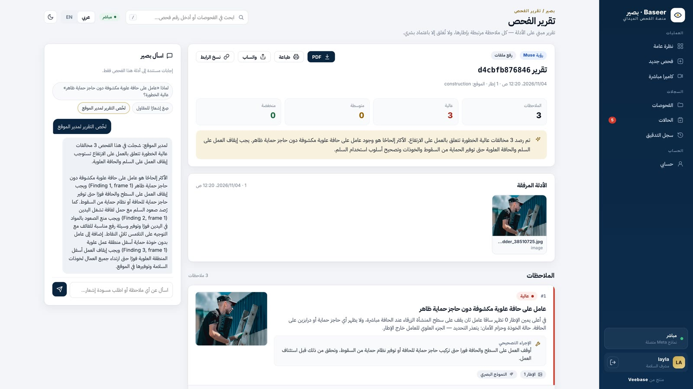 | 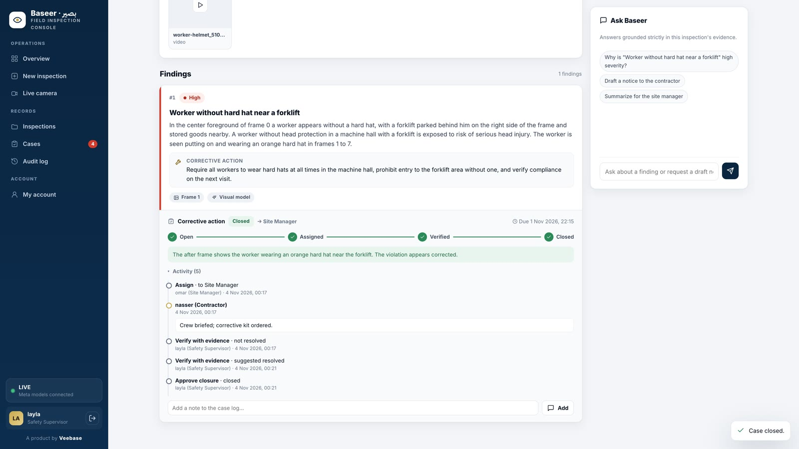 |
| **Arabic, right to left:** the same report and chat in Arabic | **Verified closure:** wrong photo refused, real after-photo accepted, a person approves |
| 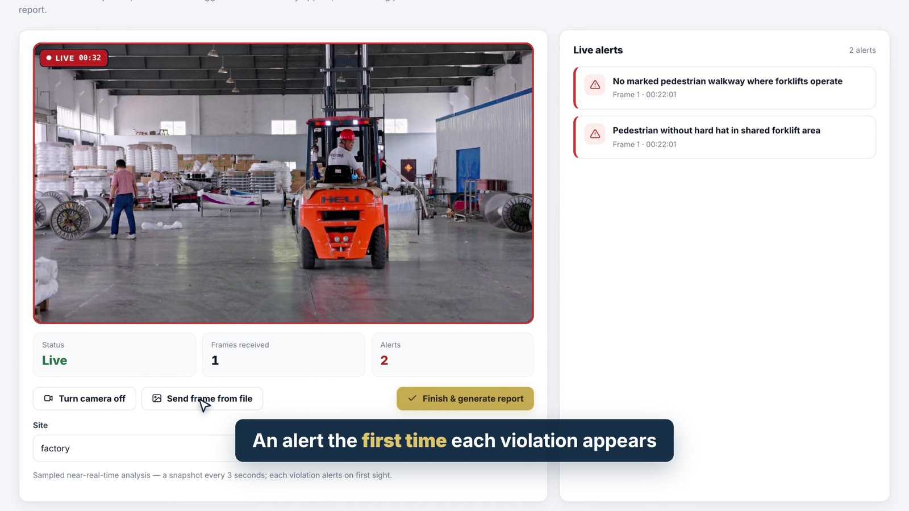 | 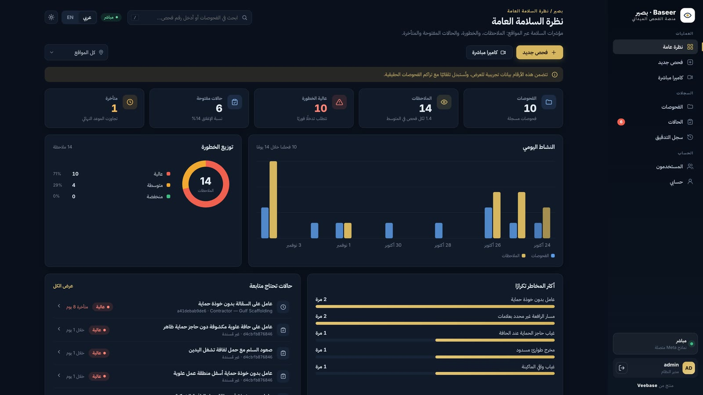 |
| **Live camera:** alerts on first sight of each violation | **Dark mode, Arabic:** the whole console mirrors right to left |
| 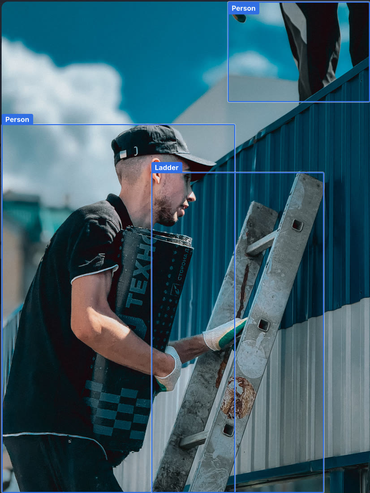 | 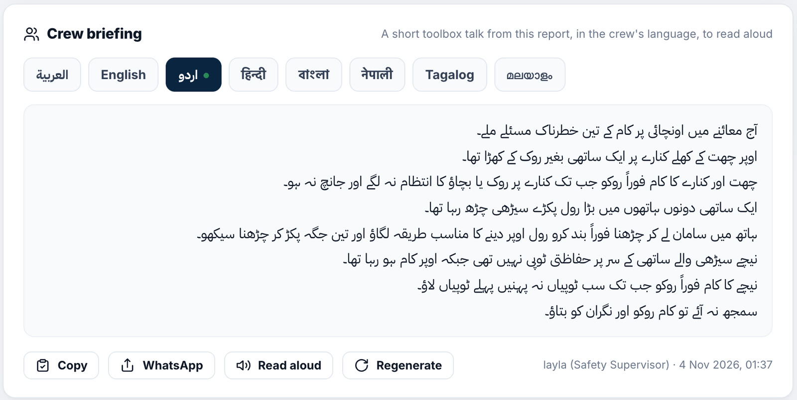 |
| **SAM 3.1 on the evidence:** real segments (people, ladder) drawn where SAM found them | **Crew briefing:** a read-aloud toolbox talk in the crew's language, shown here in Urdu |
| 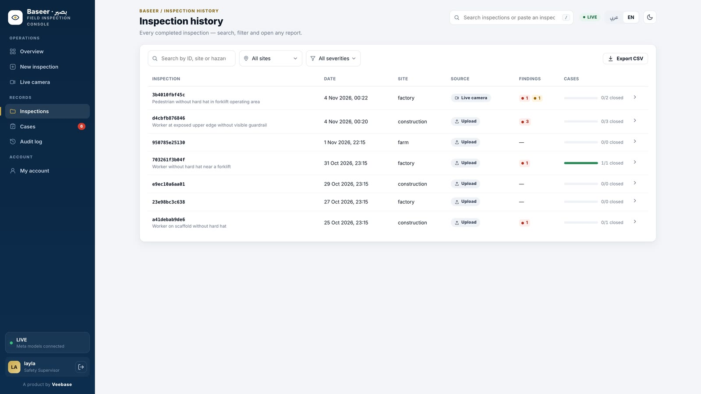 | 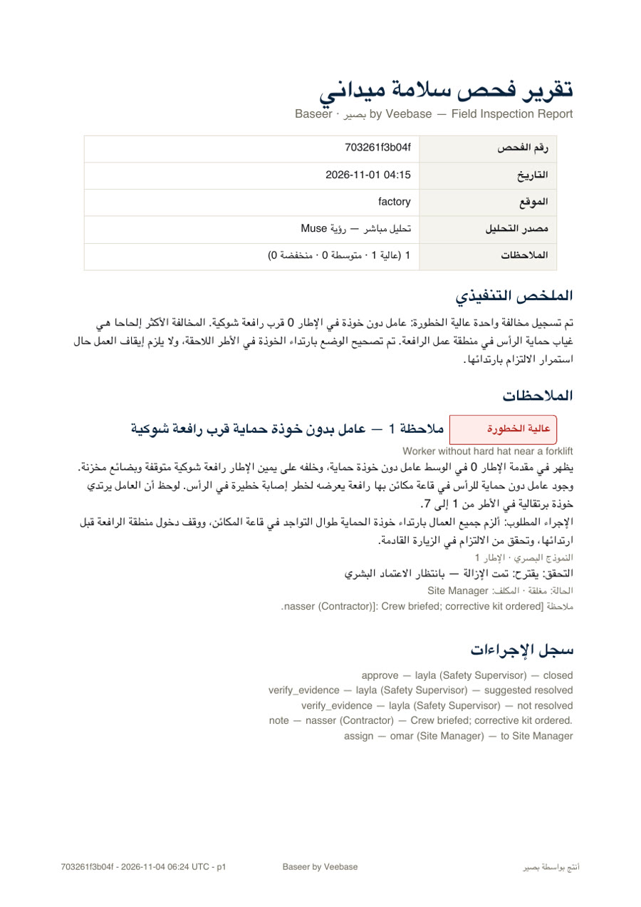 |
| **History:** search and filter every inspection, export CSV | **Arabic PDF:** server-rendered report with the full audit trail |

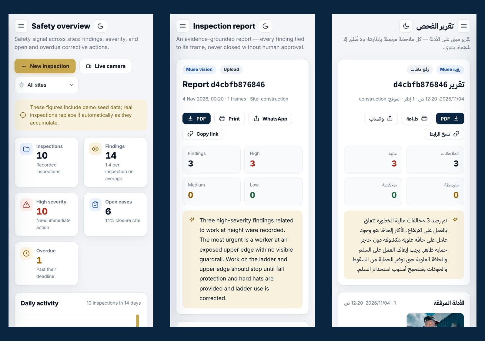
*Installable on phones for the walk itself: overview, a report, and the same report in Arabic.*

Baseer turns a short phone video or photo set from a worksite into a finished
inspection report — then opens a corrective-action case for what it found,
and verifies the fix on re-inspection, with a human approving every closure. **SAM 3.1** segments the scene — equipment, workers, PPE,
vehicles, visible hazards — and **Muse Spark** reasons over those segments
together with the inspector's Arabic voice or text notes. **Live note
(Oct 27): SAM 3.1 answers via the Responses API — the Oct 26 404 was the
Chat Completions surface, not a team gate. The live path uses SAM in auto
mode and falls back to Muse's own multimodal vision on the frames when SAM
is unreachable — same report schema either way. The report records
`segmentation_source` so the difference is always visible.** The output is a
structured report in Arabic (with an English summary): every finding carries a
severity, the exact frame as evidence, and a recommended corrective action.

Built for the **Meta Global AI Developer Hackathon** (Startup track ·
*Build for Your World*), Oct 26 – Nov 4, 2026.

## Prior work — hackathon disclosure
Per the event's new-work rule: the scaffold in this repo (FastAPI backend,
mock pipeline, bilingual frontend, eval scorer, build plan) was authored
Oct 21, 2026, before the event, as preparation. All event-week work — live
Meta Model API integration (SAM 3.1 + Muse), video path, live-camera wiring,
voice notes, the evaluation run, and the demo video — starts Oct 26, 2026
and is the work submitted for judging. Demo media note: the `demo/` text
files document footage sources; large video/photo files are not stored in
this repo and are re-fetched from the sources listed in `demo/SOURCES.md`
(Pexels License).

## Input modes
1. **Upload inspection** — a photo or short video goes in, the inspection
   starts immediately, and the report lands in ~30 seconds.
2. **Live camera** — a camera connected to the system streams frames;
   Baseer samples and segments them as they arrive, raises an alert the
   moment a violation appears, and finishing the session produces the
   full report — same pipeline, same cases, same chat and analytics.
   Use cases: factories (flagship demo), construction sites, farms —
   with real footage: staged on site, openly licensed, or a live camera.

## Why
Across the Middle East, safety and quality inspections on factory floors,
construction sites, and farms are still documented with phone photos and
handwritten Arabic notes, then typed up hours later — slow, inconsistent, and
easy to miss a missing guard rail or a worker without PPE. Baseer makes the
report a by-product of the walkthrough itself.

## Run it (mock mode — no API key needed)
```bash
python3 -m venv .venv && .venv/bin/pip install -r backend/requirements.txt
cd backend
export BASEER_DATA_DIR=/tmp/baseer-demo && ../.venv/bin/python demo_seed.py   # optional demo data
BASEER_MODE=mock ../.venv/bin/uvicorn app:app --reload --port 8010
# open http://127.0.0.1:8010   (8001 = the on-site service, 8000 = reserved)
```
Mock mode runs the full pipeline with synthetic, site-aware outputs
(factory, construction, farm), always badged **Demo data**. For live mode,
copy `.env.example` to `.env`, set `BASEER_MODE=live`, and fill in the
Meta Model API values. Tests: `cd backend && ../.venv/bin/python mock_suite.py`.

## Documentation
- [User guide](docs/USER_GUIDE.md): every screen and workflow, by role
- [API reference](docs/API.md): all endpoints, payloads and errors
- [Architecture](docs/ARCHITECTURE.md): pipeline, data model, security, frontend
- [Development](docs/DEVELOPMENT.md): dev server, demo seed, tests, conventions
- [Runbook](ops/RUNBOOK.md): on-site operation, backups, YOLO, TLS
- Walkthrough video: [docs/media/baseer-walkthrough-web.mp4](docs/media/baseer-walkthrough-web.mp4) (2:58,
  narrated, recorded live on Muse Spark 1.3; 19 MB web copy. The full-quality 84 MB master is rebuilt
  from `video/`); YouTube kit with
  title, description, chapters and tags: [docs/media/YOUTUBE.md](docs/media/YOUTUBE.md), thumbnail
  `docs/media/youtube-thumbnail.png`; video source project in [video/](video/README.md)

## What's new in 0.4 (console redesign)
- **Modern bilingual console**: rebuilt UI with light and dark themes,
  full RTL/LTR mirroring, mobile layout with a drawer menu, global search
  (<kbd>/</kbd>), toasts and confirm dialogs, and deep links to any
  report or finding (`#/report/<id>?f=<n>`).
- **Inspection history**: search and filter every past report, reopen
  it with its server-stored evidence, export CSV.
- **Cases board**: every corrective action across inspections, with
  severity-based deadlines (high 1 day, medium 7, low 30), **overdue**
  tracking, status tabs and CSV.
- **Report workspace**: severity strip, evidence gallery with a viewer,
  a case stepper (Open → Assigned → Verified → Closed) with an activity
  timeline, and a docked evidence chat with suggested questions.
- **Dashboard**: overdue and closure-rate KPIs, a 14-day activity chart,
  a severity donut and hazard bars, all clickable through to records.
- **Admin**: change roles and reset passwords in the console. Every user
  can now change their own password (previously admin-only in the UI).
- **Fixes**: live-camera reports keep their evidence (it was filed under
  the session ID, so evidence downloads and the PDF appendix came back
  empty); the analytics "recent" list is date-sorted; the trend is
  zero-filled; network blips no longer sign users out.
- **Demo seed** (`backend/demo_seed.py`) and site-aware mock scenes, plus
  20+ new suite checks.
- **Installable on phones**: a web app manifest and icons, so inspectors can add
  Baseer to the home screen and open it full-screen on site.
- **Hardening**: security headers on every response (no MIME sniffing, no
  framing, same-origin referrer, camera and microphone for this origin only).
- **CI**: the mock suite runs on every push and pull request (GitHub Actions).
- **Veebase branding** across the console, the PDF report, the API and the docs.
- **SAM 3.1 on the evidence**: real SAM segments are drawn as labelled boxes on the
  finding thumbnail, in the image viewer and in the PDF's evidence appendix (hazard-type labels
  in red), with a show/hide toggle. Only genuine SAM output is drawn, never demo boxes.
- **Crew briefing in the crew's language**: one tap turns a report into a short read-aloud
  toolbox talk in Arabic, English, Urdu, Hindi, Bengali, Nepali, Tagalog or Malayalam, the
  languages Gulf site crews actually speak. Muse writes it strictly from the report's findings;
  briefings are cached per language and stamped with who generated them; copy, WhatsApp and
  read-aloud (where the device has a voice) are built in.

## Production (on-site deployment)
Sign-in is required: accounts carry one of the Safety Supervisor, Site
Manager, Contractor, or Admin roles, and every case action is stamped
`username (role)` in the audit log. State is durable — inspections, cases,
users, and the audit trail live in `data/baseer.db` (SQLite, git-ignored)
with original uploads under `data/evidence/`; interrupted live-camera
sessions resume from the database (frames rebuild from evidence). First
boot creates the `admin` user (set
`BASEER_ADMIN_PASSWORD`, otherwise a one-time password prints to the
server log). Run it as a service with `ops/com.veebase.baseer.plist`
(launchd, auto-restart, never port 8000), back up with `sh ops/backup.sh`,
and follow `ops/RUNBOOK.md` for restarts, key rotation, and staff changes.

## Scope
Core = the inspection (capture → structured report in ~30 seconds).
Two layers hang off the completed report, never before it:
- **Evidence chat** — ask Baseer about an inspection ("why is finding 1
  high?", "draft the contractor notice"); answers grounded strictly in the
  report's findings and frames, Arabic or English.
- **Analytics (light)** — the safety manager's view across reports: totals,
  severity mix, most frequent hazards, recent activity.
Integrations (WhatsApp/PDF share, VeeSign, VeeArchive, CMMS) are a stretch /
roadmap item — see BUILD_PLAN.md.

## Layout
- `backend/`: the FastAPI service. `app.py` (routes), `pipeline.py`
  (ingest → frames → segmentation → reasoning → cases), `meta_client.py`
  (Meta Model API adapter, mock/live), `prompts.py`, `live.py` (camera
  sessions), `yolo.py` (optional local PPE detector), `analytics.py`
  (dashboard, SLA deadlines, history, cases), `report_pdf.py`,
  `store.py` (SQLite), `auth.py`, `voice.py`, `mock_suite.py` (tests),
  `demo_seed.py`
- `frontend/`: the bilingual console. `index.html` (views), `app.css`
  (design system, light/dark, RTL), `app.js` (router, i18n, views)
- `docs/`: user guide, API, architecture, development, walkthrough video
- `ops/`: launchd service, backup, TLS, runbook
- `eval/`: the fixed 24-scene benchmark and its runs
- `demo/`: demo footage plan and sources (staged/public material only)
- `BUILD_PLAN.md`: day-by-day build plan and submission checklist

## Evaluation benchmark (fixed 24-scene set, vision + SAM paths)
Demo filmed on the vision path (Muse multimodal reasoning); the SAM 3.1
segmentation path is evaluated alongside it — precision 0.600, recall
0.375 — see the SAM numbers below.
24 labeled scenes from the same staged/public Pexels footage as the demo
(`demo/SOURCES.md`; binaries re-fetched via `eval/fetch_media.py`, never
committed). The set was fixed in `eval/scenes.json` before any run and
covers positives, compliant negatives, and uncertain-by-design scenes
(poor light, face out of frame, a note contradicting the image).
Method: up to 3 evenly spaced frames per scene through the live vision
pipeline (`eval/run_live.py`), finding titles mapped to hazard labels by a
fixed keyword map; unmapped titles count as their own label so surprises
are scored, never dropped. Scored with `eval/score.py`. Both runs below
used the identical set, harness, and map; per-model evidence lives in
`eval/runs-spark/` and `eval/runs-wonder/`.

Spark 1.3 (dev default, Oct 26, prompt v1.2): precision 0.128, recall 0.75,
F1 0.218 (TP 6, FP 41, FN 2; 36 false alarms on 18 negative scenes).
Exact scene matches: 3/24 (flagship factory, scaffold helmet, one
compliant crew photo). Core hazards found — helmet 3/4 (F1 0.75), ladder
2/2 (F1 0.8), unmarked forklift path 1/1. Uncertainty honesty: 5 of 6
uncertain-by-design scenes carry an "uncertain" determination.

Spark 1.3 re-run (Oct 28, prompt v1.3, same fixed set/harness/map;
evidence in `eval/runs-v13s/`, `eval/predictions-v13s.json`): precision
0.429, recall 0.75, F1 0.545 (TP 6, FP 8, FN 2; 6 false alarms on 18
negative scenes). The economy rule lifts Spark the same way it lifted
Wonder — false alarms 36 → 6 at identical recall. Exact scene matches:
16/24. Remaining misses: the raised-hood welder and the ladder-carry
violation (an edge-exposure call fired instead); grinding close-ups still
draw 4 flags.

Wonder 1.0 (final-report model, Oct 26, prompt v1.2): precision 0.096,
recall 0.875, F1 0.173 (TP 7, FP 66, FN 1; 58 false alarms on 18 negative
scenes). Exact scene matches: 1/24. Recall is better — helmets 4/4,
ladders 2/2, path 1/1, contradiction scene nailed with the exact
`worker_without_helmet` label — but verbosity nearly doubles the false
alarms (66 vs 41): Wonder narrates far more "unable to verify"
observations as findings, and still missed the raised-hood welder (true
`missing_eye_protection`) while firing that label 9 times elsewhere.
Uncertainty honesty holds 6/6, but the model hedges on 23/24 scenes
while emitting findings anyway.

Wonder 1.0 re-run (Oct 27, prompt v1.3 finding-economy rule, same fixed
set/harness/map; evidence in `eval/runs-v13w/`, `eval/predictions-v13w.json`):
precision 0.412, recall 0.875, F1 0.560 (TP 7, FP 10, FN 1; 8 false alarms
on 18 negative scenes). Exact scene matches: 15/24. Recall fully preserved
(helmets 4/4, ladders 2/2, path 1/1, flagship exact) while false alarms
fell 58 → 8. 11 of 18 negative scenes come back exactly empty —
including every compliant crew/platform scene and both farm scenes.
Remaining failures, published: the raised-hood welder is STILL missed
(`missing_eye_protection` FN, fired once elsewhere on a spark close-up);
grinding/spark close-ups still draw 4 flags (disc guard, bare hands, one-hand
operation, eye protection on faceless frames); plus one flag each on the
dusk-ladder silhouette, the textile mask, and the lathe chuck; two positives
gained one extra finding each (a helmet call on the facade ladder, a
roof-edge call on the ladder-carry). Uncertainty honesty: uncertain
determinations now appear only where a finding exists (3 scenes), instead
of hedging everywhere.

SAM path (Oct 27, live SAM 3.1 segmentation via Responses API + Wonder 1.0
reasoning, prompt v1.3, same fixed set/harness/map; evidence in
`eval/runs-sam-v13/`, `eval/predictions-sam-v13.json`): precision 0.600,
recall 0.375, F1 0.462 (TP 3, FP 2, FN 5; 1 false alarm on 18 negative
scenes). Exact scene matches: 19/24. Opposite profile to vision: the
highest precision of any run, but recall drops — the SAM path misses the
flagship forklift path, the raised-hood welder, both ladder-carry
violations, and halves the facade-ladder call (helmet instead of ladder
work). Only 2 false positives in all 24 scenes.
Failure list: 5 misses (flagship path, welder hood, 2x ladder-carry,
facade ladder-work) vs 2 false flags (a vest call on the compliant crew,
a helmet call on the facade ladder).
Vest-flag investigation (evidence, no tuning): on the compliant-crew photo
SAM returns 4 person + 4 hard-hat + 4 safety-vest segments with vest boxes
overlapping the person boxes — and the photo shows all four workers in
hi-vis. The segments are correct; the reasoner minted "Worker without a
safety vest" anyway (likely the partially occluded worker behind netting).
Verdict: reasoning over-flag, NOT a SAM mislabel. A code-side overlap
guard was then built and measured — and reverted the same day. Forensics:
SAM returns 4 persons but only 3 vests for that photo on most calls (one
vest detection drops out run to run), so some worker is always "uncovered"
and the guard can never fire there; meanwhile it risks dropping true
violations whenever boxes happen to overlap (a held helmet inside a person
box reads as "worn"). A full 24-scene guard run scored P 0.400 / R 0.250 /
F1 0.308 — worse than unguarded SAM — so the guard was removed, not
shipped. Lesson recorded: box-count association cannot fix reasoning
over-flags on noisy per-call segments.
Path switching verified live: auto mode uses SAM when enabled
(`segmentation_source: sam` on upload and live-camera finish); with SAM
unreachable (bogus model name forcing a 404) uploads fall back to vision
and live sessions pin vision (`segmentation_source: vision` both cases).

Shared failures (published, not tuned away):
- Over-eager observations: clean negatives almost always draw flags —
  mostly cautious "unable to verify X" wordings, but also genuine
  hallucinations (bare hands on gloved hands, a hanging mask on a masked
  textile worker, an uncapped-rebar call on a compliant crew photo).
- Compliant scenes rarely come back exactly empty; hedging plus findings
  at once inflates precision damage.

Takeaway for production: recall first is the right bias for safety, and
the v1.3 economy rule proved the verbosity was prompt-fixable on Wonder
(F1 0.173 → 0.560, same recall). Remaining work is model-side, not
prompt-side: the missed raised-hood welder and the grinding-close-up
flags need better visual grounding, not stricter wording.
Verdict stands: Spark for cheap dev loops (~7x cheaper per the Day-0 A/B),
Wonder for final reports (higher recall, richer actions); a Spark v1.3
re-run is still open and would test whether the economy rule lifts its
F1 0.218 the same way.

## License

The code is released under the [MIT License](LICENSE), © 2026 Veebase.

Third-party material in this repository keeps its own terms:
- **Site photos and footage** in the screenshots, the preview GIF, the thumbnail and the
  walkthrough video come from Pexels under the [Pexels License](https://www.pexels.com/license/);
  the creators are listed in `demo/SOURCES.md` and `docs/media/YOUTUBE.md`.
- **Click sounds** in `video/assets/sfx/` come from the HyperFrames bundled library (Apache-2.0).
- **The walkthrough video's music** was generated with MusicGen, whose model weights are licensed
  CC-BY-NC 4.0 (non-commercial); its narration voice is Kokoro (Apache-2.0).
- **Meta model outputs** shown in the media (SAM 3.1, Muse) are subject to Meta's Model API terms.

---
*Baseer is a Veebase product. © 2026 Veebase.*
